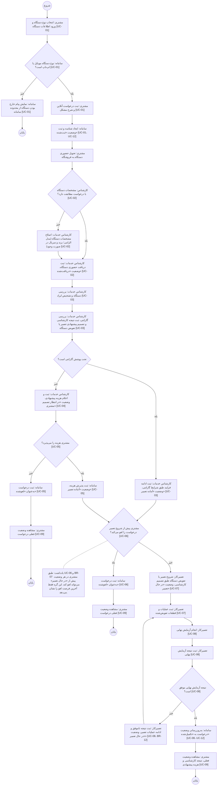

# Activity Diagram سامانه GaranTech

بازیگران و وضعیت‌ها طبق بخش 1.4 SRS؛ شناسه‌های UC در انتهای هر گام آمده است.

**توضیح:** نبود قطعه خارج از محدوده این نسخه است (بخش 7 SRS) و در نمودار نیامده است.
