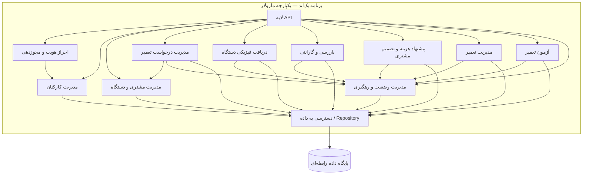

# نمودار مؤلفه‌ها — C4 Component

## ۱. هدف و محدوده

این نمودار ساختار منطقی داخل کانتینر Backend Application را نشان می‌دهد. مؤلفه‌ها ماژول‌های منطقی درون یک برنامه واحد هستند؛ هر مؤلفه سرویس مستقل یا فرایند جداگانه‌ای نیست.

مرزهای زیر بر اساس مسئولیت‌های کسب‌وکار GaranTech تعریف شده‌اند. یک مؤلفه ممکن است در لایه‌های مختلف، بخش‌های متناظر داشته باشد.

## ۲. مؤلفه‌ها و مسئولیت‌ها

| مؤلفه | مسئولیت |
|---|---|
| API Layer | دریافت درخواست‌های HTTP، تبدیل ورودی/خروجی و فراخوانی موارد کاربرد |
| Authentication & Authorization | احراز هویت کارکنان و بررسی مجوز عملیات |
| Staff Management | مدیریت حساب کارکنان، نقش و فعال/غیرفعال بودن |
| Customer & Device Management | ایجاد یا بازیابی مشتری با شماره تلفن نرمال‌شده و مدیریت اطلاعات دستگاه |
| Repair Request Management | ثبت درخواست و هماهنگی گردش‌کار اصلی درخواست |
| Device Reception | ثبت تحویل فیزیکی دستگاه و اطلاعات دریافت |
| Inspection & Warranty | ثبت بازرسی و عیب‌ها، تعیین واجدشرایط‌بودن گارانتی و اقدام پیشنهادی |
| Proposal & Customer Decision | ثبت پیشنهاد هزینه و تصمیم پذیرش/رد مشتری |
| Repair Management | مدیریت کار تعمیر و عملیات تعمیر، تعویض قطعه یا تعویض دستگاه |
| Repair Testing | ثبت آزمون‌های نهایی و نتایج آن‌ها |
| Status & Tracking | اعتبارسنجی انتقال وضعیت، ثبت تاریخچه و ارائه اطلاعات مجاز رهگیری |
| Data Access / Repositories | پیاده‌سازی دسترسی پایدار به داده‌ها |

## ۳. نمودار مؤلفه‌ها

این نمودار وابستگی‌های منطقی سطح بالا را نشان می‌دهد، نه ترتیب دقیق اجرای همه عملیات‌ها. جزئیات تعاملات و مرز تراکنش‌ها در زمان طراحی موارد کاربرد و پیاده‌سازی دقیق‌تر می‌شوند.

## ۴. قواعد مهم میان مؤلفه‌ها

### ۴.۱. مدیریت مرکزی وضعیت

هیچ مؤلفه کسب‌وکار نباید وضعیت درخواست را به‌صورت مستقل و بدون اعتبارسنجی تغییر دهد. مؤلفه مربوطه نتیجه عملیات را به Status & Tracking اعلام می‌کند؛ این مؤلفه انتقال مجاز را بررسی و تاریخچه وضعیت را ثبت می‌کند.

وضعیت‌های تعریف‌شده:
- REGISTERED
- RECEIVED
- INSPECTED
- AWAITING_CUSTOMER_DECISION
- READY_FOR_REPAIR
- IN_REPAIR
- COMPLETED
- CANCELLED

نمونه قواعد:
- درخواست گارانتی واجدشرایط پس از بازرسی به READY_FOR_REPAIR می‌رسد.
- درخواست خارج از گارانتی پس از ثبت پیشنهاد به AWAITING_CUSTOMER_DECISION می‌رسد.
- پذیرش پیشنهاد، درخواست را به READY_FOR_REPAIR می‌برد.
- رد پیشنهاد، درخواست را CANCELLED می‌کند.
- شروع تعمیر، وضعیت را IN_REPAIR می‌کند.
- آزمون ناموفق، درخواست را IN_REPAIR نگه می‌دارد.
- آزمون نهایی موفق، امکان انتقال به COMPLETED را فراهم می‌کند.
- پس از شروع تعمیر، لغو درخواست مجاز نیست.

### ۴.۲. جدایی بازرسی از عملیات تعمیر

Inspection & Warranty نتیجه بررسی و اقدام پیشنهادی را ثبت می‌کند. Repair Management عملیات واقعی انجام‌شده توسط تعمیرکار را ثبت می‌کند. این دو مفهوم نباید با هم ادغام شوند.

### ۴.۳. جدایی پیشنهاد هزینه از عملیات تعمیر

RepairJob و RepairJobOperation باید برای تعمیرهای گارانتی و خارج از گارانتی قابل استفاده باشند؛ بنابراین عملیات تعمیر نباید به وجود RepairProposal وابسته باشد.

### ۴.۴. رهگیری مشتری

مشتری با کد رهگیری و شماره تلفن ثبت‌شده درخواست را پیگیری می‌کند. پاسخ این مؤلفه باید فقط اطلاعات مجاز برای مشتری را برگرداند و نباید یادداشت‌های داخلی بازرسی یا اطلاعات حساس کارکنان را افشا کند.

## ۵. نگاشت به لایه‌ها

- API Layer در Presentation قرار می‌گیرد.
- هماهنگی موارد کاربرد در Application انجام می‌شود.
- قواعد وضعیت، گارانتی، تصمیم مشتری و تعمیر در Domain قرار می‌گیرند.
- پیاده‌سازی Repositoryها و ارتباط با DB در Infrastructure قرار می‌گیرد.

مؤلفه‌های کسب‌وکار می‌توانند در بیش از یک لایه بخش‌هایی داشته باشند؛ مؤلفه و لایه دو مفهوم متفاوت‌اند.

## ۶. تصمیم‌های مرتبط

- ADR-004: معماری چهارلایه
- ADR-005: مدیریت متمرکز وضعیت
- ADR-008: مجوزدهی در سمت بک‌اند
