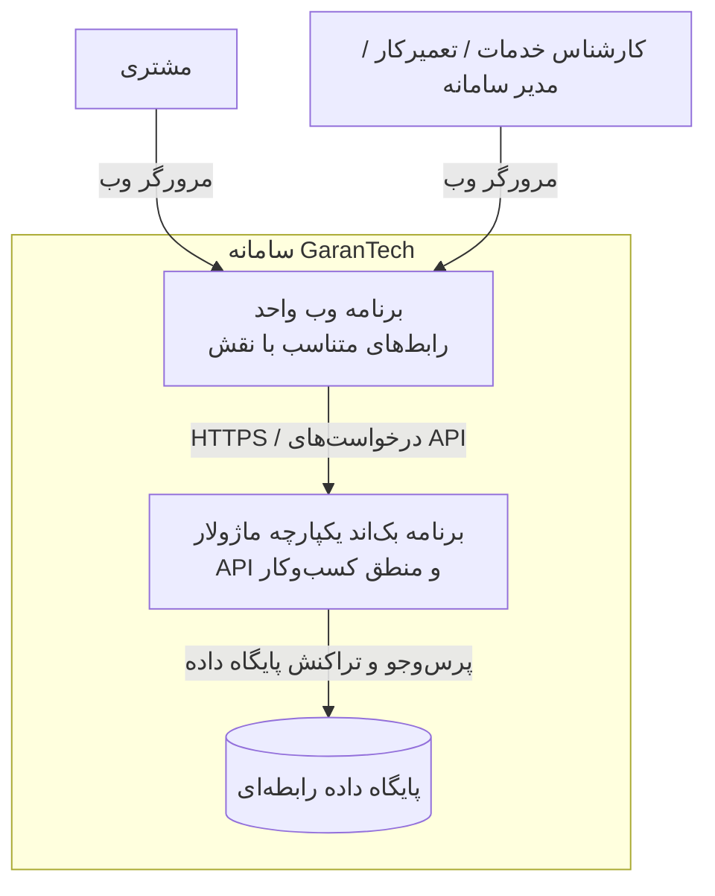

# نمودار کانتینرها — C4 Container

## ۱. هدف

این نمودار اجزای اجرایی اصلی GaranTech و ارتباط میان آن‌ها را نشان می‌دهد. در مدل C4، «کانتینر» به یک برنامه یا مخزن داده قابل اجرا/استقرار اشاره دارد و الزاماً به معنی Docker Container نیست.

## ۲. کانتینرهای پیشنهادی

### ۲.۱. برنامه وب (Web Application)

رابط کاربری واحد برای مشتری و کارکنان است. بر اساس نقش کاربر، صفحات و قابلیت‌های مرتبط نمایش داده می‌شوند.

مسئولیت‌ها:
- ارائه فرم ثبت درخواست برای مشتری
- ارائه صفحه پیگیری با کد رهگیری و شماره تلفن
- نمایش پیشنهاد هزینه و دریافت تصمیم مشتری
- ارائه محیط کاری کارشناس خدمات، تعمیرکار و مدیر سامانه
- نمایش خطاها و پاسخ‌های دریافتی از بک‌اند

مخفی‌کردن یک صفحه یا دکمه در فرانت‌اند به‌تنهایی کنترل دسترسی محسوب نمی‌شود؛ مجوز هر عملیات حساس باید در بک‌اند نیز بررسی شود.

### ۲.۲. برنامه بک‌اند (Backend Application)

یک **Modular Monolith** است؛ یعنی یک برنامه بک‌اند واحد که از ماژول‌های داخلی با مسئولیت‌های مشخص تشکیل می‌شود.

مسئولیت‌ها:
- ارائه API به برنامه وب
- اجرای موارد کاربرد و هماهنگی گردش‌کارها
- اعمال قوانین کسب‌وکار
- احراز هویت کارکنان و کنترل مجوزها
- مدیریت وضعیت درخواست و تاریخچه آن
- دسترسی کنترل‌شده به داده‌ها

### ۲.۳. پایگاه داده رابطه‌ای (Relational Database)

داده‌های پایدار سامانه را ذخیره می‌کند؛ از جمله مشتریان، دستگاه‌ها، درخواست‌ها، کارکنان، دریافت دستگاه، بازرسی، پیشنهاد هزینه، تصمیم مشتری، عملیات تعمیر، آزمون‌ها و تاریخچه وضعیت.

## ۳. نمودار

## ۴. ارتباط کانتینرها

| مبدأ | مقصد | نوع ارتباط | هدف |
|---|---|---|---|
| مشتری | برنامه وب | استفاده از مرورگر | ثبت درخواست و پیگیری |
| کارکنان | برنامه وب | استفاده از مرورگر | انجام عملیات متناسب با نقش |
| برنامه وب | بک‌اند | HTTPS و API | ارسال درخواست و دریافت پاسخ |
| بک‌اند | پایگاه داده | دسترسی پایگاه داده | خواندن و ثبت اطلاعات |

برنامه وب مستقیماً به پایگاه داده متصل نمی‌شود. تمام دسترسی به داده‌ها از طریق بک‌اند انجام می‌شود تا قوانین کسب‌وکار و مجوزها در یک نقطه قابل کنترل باشند.

## ۵. انتخاب‌های معماری و گزینه‌های ردشده

- **یک برنامه وب:** برای جلوگیری از نگهداری دو کدبیس فرانت‌اند، رابط‌های مشتری و کارکنان در یک برنامه با مسیرها و دسترسی‌های متفاوت ارائه می‌شوند.
- **بک‌اند یکپارچه ماژولار:** در مقیاس و محدوده فعلی پروژه، استقرار و توسعه یک برنامه ساده‌تر از چند ریزخدمت مستقل است. مرزبندی ماژول‌ها همچنان ضروری است.
- **پایگاه داده رابطه‌ای:** با توجه به روابط روشن میان موجودیت‌ها، کلیدهای خارجی و نیاز به تراکنش، انتخاب مناسبی است.

## ۶. مواردی که هنوز تعیین نشده‌اند

- فریم‌ورک و زبان نهایی فرانت‌اند
- فریم‌ورک بک‌اند
- محصول مشخص DBMS
- محل و روش استقرار
- سرویس‌های خارجی احتمالی

این موارد نباید بدون تصمیم تیم به‌عنوان فناوری قطعی در نمودار ثبت شوند.

## ۷. تصمیم‌های مرتبط

- ADR-001: برنامه وب واحد
- ADR-002: بک‌اند یکپارچه ماژولار
- ADR-003: پایگاه داده رابطه‌ای
