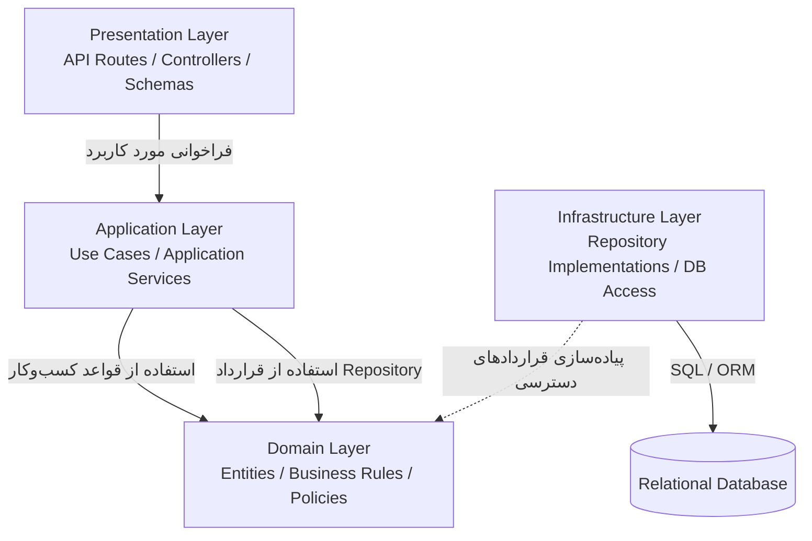

# معماری لایه‌ای بک‌اند GaranTech

## ۱. هدف

معماری لایه‌ای مسئولیت‌های فنی و کسب‌وکاری بک‌اند را جدا می‌کند تا قوانین اصلی GaranTech به جزئیات FastAPI، پروتکل HTTP و فناوری پایگاه داده وابسته نباشند. FastAPI فریم‌ورک منتخب برای پیاده‌سازی مرز ورودی HTTP در لایه Presentation است.

ساختار پیشنهادی شامل چهار لایه است:
1. Presentation
2. Application
3. Domain
4. Infrastructure

پایگاه داده رابطه‌ای یک مخزن داده خارج از این چهار لایه است.

## ۲. نمودار لایه‌ها و وابستگی‌ها

فلش‌ها وابستگی طراحی را نشان می‌دهند، نه الزاماً تمام مسیر اجرای زمان اجرا. لایه‌های داخلی نباید به جزئیات فنی لایه‌های بیرونی وابسته باشند. در صورت تعریف قرارداد Repository در Domain یا Application، Infrastructure آن قرارداد را پیاده‌سازی می‌کند.

## ۳. شرح لایه‌ها

### ۳.۱. Presentation Layer

**مسئولیت‌ها**
- تعریف مسیرها و نقاط پایانی API
- دریافت و تبدیل درخواست HTTP
- اعتبارسنجی قالب و نوع ورودی‌ها
- اعمال کنترل‌های اولیه دسترسی
- فراخوانی Application Service مناسب
- تبدیل نتیجه یا خطا به پاسخ HTTP

**نباید شامل این موارد باشد**
- تصمیم‌گیری درباره واجدشرایط‌بودن گارانتی
- تعیین انتقال وضعیت مجاز
- منطق پذیرش یا رد پیشنهاد
- اجرای مستقیم پرس‌وجوهای پایگاه داده
- پیاده‌سازی گردش‌کارهای چندمرحله‌ای

### ۳.۲. Application Layer

**مسئولیت‌ها**
- پیاده‌سازی هماهنگی موارد کاربرد
- فراخوانی مؤلفه‌ها و سرویس‌های دامنه
- مدیریت مرز تراکنش در عملیات مرتبط
- هماهنگی Repositoryها و سرویس‌های موردنیاز
- تبدیل خروجی مورد کاربرد به نتیجه مناسب برای Presentation

نمونه موارد کاربرد:
- RegisterRepairRequest
- ReceiveDevice
- InspectDevice
- CreateRepairProposal
- RecordCustomerDecision
- StartRepair
- RecordRepairOperation
- RecordFinalTest
- TrackRepairRequest
- ManageStaffAccount

**نباید شامل این موارد باشد**
- جزئیات HTTP یا قالب پاسخ API
- دستورهای SQL یا جزئیات DBMS
- کپی‌کردن قواعد اصلی دامنه در چند سرویس کاربردی

### ۳.۳. Domain Layer

**مسئولیت‌ها**
- مدل‌کردن مفاهیم اصلی کسب‌وکار
- تعریف قواعد و محدودیت‌های دامنه
- اعتبارسنجی انتقال وضعیت
- تعیین شرایط گارانتی و پیشنهاد هزینه بر اساس قواعد نیازمندی
- تعیین شرایط شروع، ادامه و تکمیل تعمیر
- تعریف قراردادهای موردنیاز برای دسترسی به داده، در صورت انتخاب این رویکرد

نمونه قواعد:
- برای درخواست واجدشرایط گارانتی، پیشنهاد هزینه خارج از گارانتی ایجاد نمی‌شود.
- پذیرش یا رد پیشنهاد فقط برای پیشنهاد معتبر ثبت می‌شود.
- شروع تعمیر فقط از وضعیت READY_FOR_REPAIR مجاز است.
- لغو پس از شروع تعمیر مجاز نیست.
- آزمون ناموفق به‌تنهایی وضعیت را COMPLETED نمی‌کند.
- تکمیل درخواست به ثبت آزمون نهایی موفق وابسته است.

**نباید وابسته باشد به**
- جزئیات FastAPI یا فریم‌ورک وب
- HTTP و ساختار Request/Response
- SQLAlchemy یا ORM مشخص
- جزئیات PostgreSQL، SQL یا DBMS مشخص

### ۳.۴. Infrastructure Layer

**مسئولیت‌ها**
- پیاده‌سازی Repositoryها
- مدیریت اتصال و نشست پایگاه داده
- اجرای عملیات خواندن و نوشتن
- نگاشت مدل‌های پایدار به مدل‌های دامنه، در صورت نیاز
- پیاده‌سازی سازوکارهای فنی مانند هش‌کردن رمز عبور
- مدیریت جزئیات فنی تراکنش و ذخیره‌سازی مطابق مرز تعیین‌شده در Application

**نباید شامل این موارد باشد**
- تصمیم‌های کسب‌وکار مانند تعیین نتیجه گارانتی
- تعیین مجازبودن لغو درخواست
- تصمیم‌گیری درباره تکمیل تعمیر بر اساس نتیجه آزمون

## ۴. نمونه جریان اجرا: پذیرش پیشنهاد هزینه

سناریو: مشتری پیشنهاد هزینه مربوط به یک درخواست خارج از گارانتی را می‌پذیرد.

1. Presentation درخواست مشتری را دریافت و قالب آن را بررسی می‌کند.
2. Application مورد کاربرد ثبت تصمیم مشتری را آغاز می‌کند.
3. Application از طریق قرارداد Repository، پیشنهاد و درخواست مربوط را بازیابی می‌کند.
4. Domain اعتبار پیشنهاد، امکان ثبت تصمیم و انتقال وضعیت را بررسی می‌کند.
5. Application عملیات ثبت تصمیم، تغییر وضعیت به READY_FOR_REPAIR و ثبت StatusHistory را هماهنگ می‌کند.
6. Infrastructure تغییرات را در پایگاه داده ذخیره می‌کند.
7. در صورت موفقیت همه تغییرات، Presentation پاسخ موفق برمی‌گرداند.

تغییر تصمیم مشتری، وضعیت درخواست و تاریخچه مرتبط باید به‌صورت سازگار و در یک تراکنش مناسب ذخیره شوند. اگر ذخیره‌سازی شکست بخورد، نباید پاسخ موفق به مشتری داده شود.

## ۵. نگاشت مؤلفه‌ها به لایه‌ها

| مؤلفه | لایه یا لایه‌های اصلی |
|---|---|
| API Layer | Presentation |
| Authentication & Authorization | Presentation و Application؛ قواعد مجوز در سیاست‌های دامنه/کاربرد در صورت نیاز |
| Staff Management | Application و Domain؛ Repository در Infrastructure |
| Customer & Device Management | Application و Domain؛ Repository در Infrastructure |
| Repair Request Management | Application و Domain؛ Repository در Infrastructure |
| Device Reception | Application و Domain؛ Repository در Infrastructure |
| Inspection & Warranty | Application و Domain؛ Repository در Infrastructure |
| Proposal & Customer Decision | Application و Domain؛ Repository در Infrastructure |
| Repair Management | Application و Domain؛ Repository در Infrastructure |
| Repair Testing | Application و Domain؛ Repository در Infrastructure |
| Status & Tracking | Application و Domain؛ Repository در Infrastructure |
| Data Access / Repositories | Infrastructure |

## ۶. قواعد وابستگی

1. Presentation فقط از طریق Application عملیات کسب‌وکار را اجرا می‌کند.
2. Application قواعد دامنه را فراخوانی می‌کند و گردش‌کار را هماهنگ می‌سازد.
3. Domain به لایه‌های بیرونی وابسته نیست.
4. Infrastructure جزئیات فنی قراردادهای موردنیاز لایه‌های داخلی را پیاده‌سازی می‌کند.
5. هیچ لایه‌ای نباید برای دورزدن قواعد دامنه، مستقیماً وضعیت درخواست را تغییر دهد.
6. فرانت‌اند مستقیماً به پایگاه داده متصل نمی‌شود.

## ۷. تصمیم‌های مرتبط

- ADR-004: معماری چهارلایه
- ADR-007: تراکنش‌های پایگاه داده
- ADR-008: مجوزدهی در سمت بک‌اند
