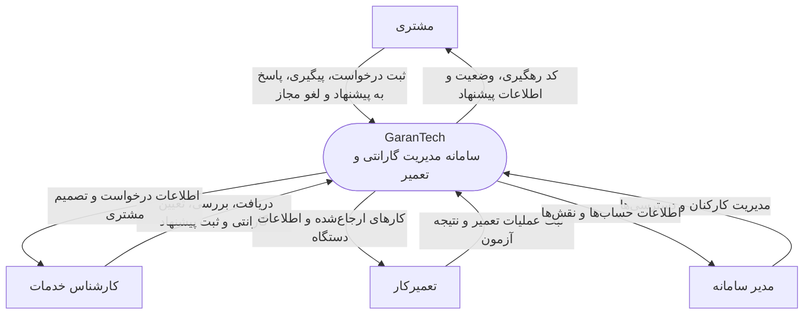

# نمودار زمینه سامانه — C4 System Context

## ۱. هدف

این نمودار GaranTech را به‌عنوان یک سامانه واحد نشان می‌دهد و مشخص می‌کند چه افرادی مستقیماً با آن تعامل دارند. در این سطح، جزئیات داخلی مانند لایه‌ها، ماژول‌ها، کلاس‌ها و جداول پایگاه داده نمایش داده نمی‌شوند.

## ۲. مرز سامانه

GaranTech سامانه‌ای برای ثبت، مدیریت و پیگیری درخواست‌های گارانتی و تعمیر موبایل و لپ‌تاپ است. سامانه از زمان ثبت درخواست تا دریافت دستگاه، بررسی، تصمیم گارانتی، اعلام هزینه در صورت نیاز، انجام تعمیر و آزمون نهایی، وضعیت درخواست را مدیریت می‌کند.

## ۳. بازیگران و تعامل‌ها

| بازیگر | تعامل با سامانه |
|---|---|
| مشتری (Customer) | ثبت مستقیم درخواست، دریافت کد رهگیری، پیگیری وضعیت با کد رهگیری و شماره تلفن، مشاهده پیشنهاد هزینه، پذیرش یا رد پیشنهاد و لغو درخواست در بازه مجاز |
| کارشناس خدمات (Service Expert) | مشاهده درخواست، ثبت دریافت فیزیکی دستگاه، بررسی دستگاه، ثبت عیب‌ها، تعیین نتیجه گارانتی، ثبت اقدام پیشنهادی و ایجاد پیشنهاد هزینه برای موارد خارج از گارانتی |
| تعمیرکار (Technician) | مشاهده کارهای تعمیر ارجاع‌شده، ثبت عملیات تعمیر یا تعویض قطعه/دستگاه و ثبت نتیجه آزمون |
| مدیر سامانه (System Admin) | مدیریت حساب‌های کارکنان و نقش‌ها و دسترسی‌های آنان مطابق محدوده نیازمندی‌ها |

## ۴. نمودار

## ۵. فرضیات و مرزبندی

1. مشتری مستقیماً از رابط وب استفاده می‌کند؛ ثبت درخواست منحصراً از طریق کارمند انجام نمی‌شود.
2. مشتری حساب کاربری و فرایند ورود معمول کارکنان ندارد. دسترسی به پیگیری با کد رهگیری و شماره تلفن ثبت‌شده انجام می‌شود.
3. کارکنان سامانه با حساب سازمانی وارد می‌شوند.
4. در نیازمندی‌های فعلی، هیچ سامانه خارجی قطعی مانند درگاه پرداخت، سرویس پیامک، ایمیل یا سامانه بیرونی استعلام گارانتی تعریف نشده است؛ بنابراین در نمودار زمینه نمایش داده نشده است.
5. این نمودار فقط تعاملات سطح بالا را نشان می‌دهد و جزئیات پروتکل ارتباطی یا فناوری را تعیین نمی‌کند.

## ۶. تصمیم‌های مرتبط

- ADR-001: یک برنامه وب با رابط‌های متناسب با نقش‌ها
- ADR-006: امنیت دسترسی مشتری به اطلاعات رهگیری
- ADR-008: کنترل مجوزها در سمت بک‌اند
