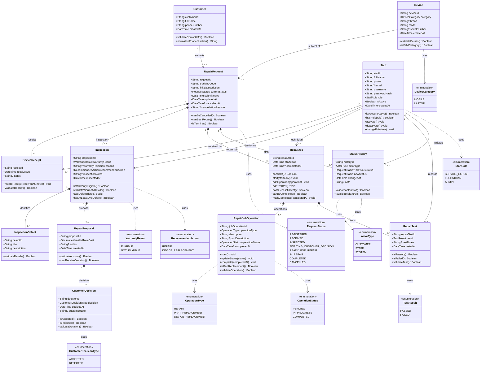
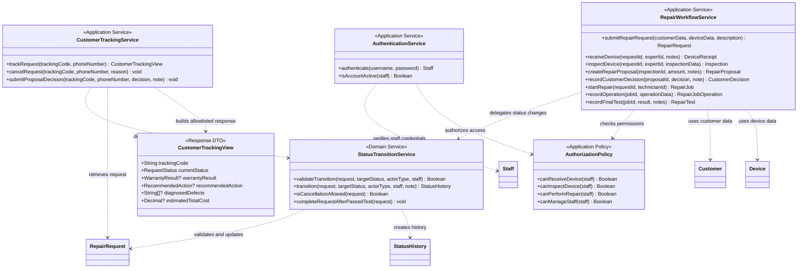

# UML Class Diagram — GaranTech

**نام گروه:** توکیو  
**مسئول طراحی:** طاها رزم‌آذر  
**نوع سند:** Software Design — UML Domain Class Diagram  
**نسخه:** 1.2  
**مبنای طراحی:** تسک طراحی Class Diagram، مدل داده منطقی، ERD، SRS نسخه 0.3، Use Cases، Activity Diagram و اسناد معماری  
**تعداد Entityهای اصلی دامنه:** 13  
**وضعیت:** نسخه اصلاح‌شده بر اساس بازخورد بازبینی‌کننده

## 1. هدف و محدوده

هدف این سند، طراحی مدل شیءگرای دامنه GaranTech است؛ به‌گونه‌ای که علاوه بر داده‌ها، مسئولیت‌ها، رفتارها، روابط و محدودیت‌های مهم کلاس‌ها را مشخص کند. این نمودار صرفاً تبدیل ۱۳ جدول به ۱۳ کلاس نیست.

نمودار اصلی فقط کلاس‌های دامنه و Enumها را نشان می‌دهد. سرویس‌های هماهنگ‌کننده در نمودار جداگانه آمده‌اند تا Entityها با Application Serviceها مخلوط نشوند.

**اصول طراحی**
- مشتری برای ثبت درخواست یا پیگیری آن حساب کاربری ندارد.
- پیگیری درخواست با `trackingCode` و `phoneNumber` انجام می‌شود.
- نقش کارکنان با `StaffRole` مشخص می‌شود؛ برای هر نقش زیرکلاس جداگانه ساخته نشده است.
- تمام تغییرات `currentStatus` از مسیر مرکزی `StatusTransitionService` انجام می‌شوند.
- `RepairProposal` فقط برای درخواست خارج از پوشش گارانتی ساخته می‌شود.
- `RecommendedAction` تصمیم کارشناسی درباره کل دستگاه است؛ `OperationType` عملیات واقعی تعمیرکار را نشان می‌دهد.
- آزمایش ناموفق، درخواست را در `IN_REPAIR` نگه می‌دارد؛ آزمایش موفق امکان تکمیل درخواست را فراهم می‌کند.
- این سند شامل کلاس‌های Request/Response مربوط به FastAPI، کلاس‌های ORM، جدول‌های PostgreSQL یا موجودیت انبار قطعات نیست.

## 2. نمودار اصلی UML Class Diagram

> نمودار زیر Domain Class Diagram است. شناسه‌ها به‌صورت `String` نمایش داده شده‌اند تا به نوع فیزیکی شناسه در PostgreSQL وابسته نباشند. نوع دقیق شناسه در طراحی پایگاه داده تعیین می‌شود.

### 2.1 ویژگی‌های اختیاری (Nullable)

علامت `?` مستقیماً کنار نوع ویژگی در نمودار UML نشان می‌دهد که مقدار آن می‌تواند تهی (Nullable) باشد. همین ویژگی‌ها در جدول زیر نیز توضیح داده شده‌اند. برای نمونه، `String? email` یعنی مقدار ایمیل می‌تواند تهی باشد.

| کلاس | ویژگی | دلیل اختیاری بودن |
|---|---|---|
| `Device` | `brand` | ثبت برند در نیازمندی اختیاری است. |
| `Device` | `serialNumber` | ممکن است شماره سریال دستگاه در دسترس نباشد. |
| `Staff` | `email` | ایمیل در مدل داده اجباری نیست. |
| `RepairRequest` | `cancelledAt` | فقط برای درخواست لغوشده مقدار دارد. |
| `RepairRequest` | `cancellationReason` | فقط هنگام لغو، در صورت ثبت دلیل، مقدار دارد. |
| `DeviceReceipt` | `notes` | توضیحات دریافت می‌تواند ثبت نشود. |
| `Inspection` | `warrantyRejectionReason` | فقط وقتی `warrantyResult = NOT_ELIGIBLE` اجباری است. |
| `Inspection` | `inspectionNotes` | توضیحات تکمیلی می‌تواند خالی باشد. |
| `RepairProposal` | `notes` | توضیحات پیشنهاد می‌تواند ثبت نشود. |
| `CustomerDecision` | `customerNote` | توضیح مشتری اختیاری است. |
| `RepairJob` | `completedAt` | تا پیش از تکمیل موفق تعمیر تهی است. |
| `RepairJobOperation` | `partDescription` | برای عملیات‌هایی که قطعه‌ای تعویض نمی‌شود لازم نیست. |
| `RepairJobOperation` | `completedAt` | تا پیش از تکمیل عملیات تهی است. |
| `RepairTest` | `testNotes` | برای FAILED اجباری و برای PASSED اختیاری است؛ این الزام شرطی در لایه برنامه اعمال می‌شود. |
| `StatusHistory` | `previousStatus` | در رکورد اولیه درخواست تهی است. |
| `StatusHistory` | `note` | توضیح تغییر وضعیت می‌تواند ثبت نشود. |
| ارتباط `StatusHistory` با `Staff` | `changedByStaff` | برای عامل CUSTOMER یا SYSTEM تهی است؛ برای STAFF الزامی است. |

**قیدهای مرتبط با Nullable بودن**
- اگر `warrantyResult = NOT_ELIGIBLE` باشد، `warrantyRejectionReason` باید مقدار معتبر داشته باشد.
- اگر `actorType = STAFF` باشد، باید Staff متناظر مشخص شود.
- اگر `actorType = CUSTOMER` یا `SYSTEM` باشد، `changedByStaff` باید تهی باشد.
- در اولین `StatusHistory`، مقدار `previousStatus` تهی و `newStatus = REGISTERED` است.
- در وضعیت‌های غیرلغوشده، `cancelledAt` و `cancellationReason` نباید برای نشان‌دادن لغو مقداردهی شوند.

## 3. سرویس‌های هماهنگ‌کننده — نمودار جدا از Entityها

سرویس‌های زیر Entity یا موجودیت پایگاه داده نیستند. آن‌ها مسئول هماهنگی گردش‌کار، کنترل مجوز و اجرای قواعدی هستند که نباید در یک Entity منفرد قرار بگیرند.

`CustomerTrackingView` یک DTO خروجی است، نه Entity دامنه و نه جدول پایگاه داده. سرویس رهگیری فقط پس از تطبیق `trackingCode` و `phoneNumber`، نمای محدودی شامل وضعیت فعلی درخواست، نتیجه کارشناسی (وضعیت گارانتی، تصمیم پیشنهادی و شرح ایرادهای ثبت‌شده) و هزینه پیشنهادی را برمی‌گرداند. تاریخچه کامل تعمیرات، یادداشت‌های داخلی، اطلاعات کارکنان و سایر اطلاعات غیرضروری در پاسخ مشتری قرار نمی‌گیرند.

### 3.1 مرزبندی معماری چهارلایه

| لایه | مسئولیت و عناصر مرتبط |
|---|---|
| **Presentation** | FastAPI Routes و API Request/Response Schemas؛ خارج از نمودار دامنه |
| **Application** | `RepairWorkflowService`، `CustomerTrackingService`، `AuthenticationService`، `AuthorizationPolicy` و قراردادهای Repository |
| **Domain** | ۱۳ Entity، ده Enum و `StatusTransitionService` |
| **Infrastructure** | پیاده‌سازی Repositoryها، ORM، اتصال و جزئیات PostgreSQL |

- Domain نباید به FastAPI، HTTP، ORM یا PostgreSQL وابسته باشد.
- قرارداد Repository در Application تعریف و پیاده‌سازی آن در Infrastructure قرار می‌گیرد.
- سرویس‌های Application گردش‌کار چندمرحله‌ای را هماهنگ می‌کنند.
- انتقال وضعیت و ساخت `StatusHistory` باید از مسیر Domain Service مرکزی انجام شود.
- احراز هویت Staff در سرویس Application انجام می‌شود؛ Entity مربوط به Staff صرفاً داده و قواعد محلی حساب/نقش را نگه می‌دارد.
- مشتری حساب کاربری ندارد؛ `AuthenticationService` فقط برای کارکنان است.
- `trackRequest` یک `CustomerTrackingView` محدود برمی‌گرداند و هرگز کل Entity یا اطلاعات داخلی درخواست را افشا نمی‌کند.

## 4. مسئولیت و رفتار هر کلاس

### 4.1 `Customer` — مشتری

**مسئولیت:** نگهداری مشخصات هویتی و اطلاعات تماس مشتری، بدون ایجاد حساب کاربری.

**ویژگی‌ها:** `customerId`، `fullName`، `phoneNumber` و `createdAt`.

**عملیات**
- `validateContactInfo()`: بررسی کامل‌بودن و معتبر بودن اطلاعات تماس.
- `normalizePhoneNumber()`: نرمال‌سازی شماره تلفن پیش از ذخیره یا جست‌وجو.
**نکته طراحی:** یکتایی `phoneNumber` باید در سطح دامنه و با قید پایگاه داده تضمین شود. مشتری از Staff ارث‌بری نمی‌کند و رمز عبور یا نام کاربری ندارد.

### 4.2 `Device` — دستگاه

**مسئولیت:** نگهداری مشخصات دستگاه موضوع درخواست تعمیر.

**ویژگی‌ها:** `deviceId`، `category`، `brand`، `model`، `serialNumber` و `createdAt`.

**عملیات**
- `validateDetails()`: بررسی کامل بودن مشخصات مورد نیاز.
- `isValidCategory()`: اطمینان از انتخاب یکی از دسته‌بندی‌های تعریف‌شده.
**نکته طراحی:** دسته‌بندی‌های فعلی فقط `MOBILE` و `LAPTOP` هستند. `serialNumber` اختیاری است. Device موجودیت انبار یا مالکیت دستگاه نیست.

### 4.3 `RepairRequest` — درخواست تعمیر

**مسئولیت:** نگهداری درخواست مشتری، کد رهگیری و وضعیت جاری آن.

**ویژگی‌ها:** `requestId`، `trackingCode`، `initialDescription`، `currentStatus`، `submittedAt`، `updatedAt`، `cancelledAt` و `cancellationReason`.

**عملیات**
- `canBeCancelled()`: بررسی مجاز بودن لغو؛ پس از شروع تعمیر لغو مجاز نیست.
- `canStartRepair()`: بررسی آماده بودن درخواست برای شروع تعمیر.
- `isTerminal()`: تشخیص وضعیت‌های نهایی `COMPLETED` و `CANCELLED`.
**نکته طراحی:** `trackingCode` باید یکتا باشد. متدهای بررسی در Entity قرار دارند، اما تغییر `currentStatus` فقط توسط `StatusTransitionService` انجام می‌شود. Entity نباید راهی برای دور زدن اعتبارسنجی مرکزی فراهم کند.

### 4.4 `Staff` — کارکنان

**مسئولیت:** نگهداری حساب، اطلاعات و نقش کارکنان.

**ویژگی‌ها:** `staffId`، `fullName`، `phone`، `email`، `username`، `passwordHash`، `role`، `isActive` و `createdAt`.

**عملیات**
- `isAccountActive()`: بررسی فعال بودن حساب.
- `hasRole()`: بررسی نقش فعلی.
- `activate()` و `deactivate()`: فقط مدیر سامانه (`ADMIN`) می‌تواند حساب کارکنان دیگر را فعال یا غیرفعال کند؛ غیرفعال‌سازی حساب کاربری که عملیات جاری را بر عهده دارد باید طبق سیاست واگذاری/پایان عملیات انجام شود.
- `changeRole()`: فقط مدیر سامانه می‌تواند نقش را تغییر دهد. این تغییر باید ثبت ممیزی شود و نباید باعث اعطای دسترسی به عملیات خارج از نقش جدید شود.

**نکته طراحی:** نقش‌ها با `StaffRole` تعریف می‌شوند و زیرکلاس جداگانه برای Service Expert، Technician و Admin لازم نیست. احراز هویت رمز عبور در `AuthenticationService` انجام می‌شود؛ ذخیره رمز فقط به شکل هش مجاز است. مجوز هر عملیات در `AuthorizationPolicy` بررسی می‌شود.

### 4.5 `DeviceReceipt` — دریافت فیزیکی دستگاه

**مسئولیت:** ثبت تحویل فیزیکی دستگاه به فروشگاه.

**ویژگی‌ها:** `receiptId`، `receivedAt` و `notes`.

**عملیات**
- `recordReceipt()`: ثبت زمان و توضیحات دریافت.
- `validateReceipt()`: بررسی معتبر بودن اطلاعات رسید.

**نکته طراحی:** هر درخواست حداکثر یک رسید دارد. دریافت‌کننده باید Staff با نقش `SERVICE_EXPERT` باشد. این مسئولیت در `AuthorizationPolicy` کنترل می‌شود.

### 4.6 `Inspection` — بازرسی

**مسئولیت:** ثبت نتیجه بررسی دستگاه، وضعیت گارانتی و اقدام پیشنهادی کارشناس.

**ویژگی‌ها:** `inspectionId`، `warrantyResult`، `warrantyRejectionReason`، `recommendedAction`، `inspectionNotes` و `inspectedAt`.

**عملیات**
- `isWarrantyEligible()`: بررسی مشمول بودن دستگاه.
- `validateWarrantyDetails()`: الزام ثبت دلیل در صورت `NOT_ELIGIBLE`.
- `addDefect()`: افزودن عیب تشخیص‌داده‌شده.
- `hasAtLeastOneDefect()`: بررسی ثبت حداقل یک عیب.

**نکته طراحی:** هر درخواست حداکثر یک Inspection دارد. بازرسی پس از دریافت دستگاه انجام می‌شود. `recommendedAction` درباره کل دستگاه است و نباید با عملیات واقعی تعمیرکار اشتباه گرفته شود.

### 4.7 `InspectionDefect` — عیب شناسایی‌شده

**مسئولیت:** ثبت هر عیب شناسایی‌شده در بازرسی.

**ویژگی‌ها:** `defectId`، `title` و `description`.

**عملیات**
- `validateDetails()`: بررسی عنوان و شرح عیب.
**نکته طراحی:** هر Inspection حداقل یک عیب دارد. شرح اولیه مشتری در `RepairRequest` ذخیره می‌شود و با عیب تشخیص‌داده‌شده یکی نیست.

### 4.8 `RepairProposal` — پیشنهاد هزینه

**مسئولیت:** ثبت مبلغ کل پیشنهادی برای تعمیر خارج از پوشش گارانتی.

**ویژگی‌ها:** `proposalId`، `estimatedTotalCost`، `notes` و `createdAt`.

**عملیات**
- `validateAmount()`: بررسی معتبر و نامنفی بودن مبلغ.
- `canReceiveDecision()`: بررسی اینکه پیشنهاد هنوز تصمیم نهایی نگرفته باشد.

**نکته طراحی:** هر Inspection حداکثر یک پیشنهاد دارد. پیشنهاد فقط برای `NOT_ELIGIBLE` ساخته می‌شود. برای تعمیر تحت گارانتی پیشنهاد هزینه و تصمیم مشتری لازم نیست. واحد پول و دقت مبلغ باید در قراردادهای پروژه/پایگاه داده مشخص شود؛ این سند واحد جدیدی تعیین نمی‌کند.

### 4.9 `CustomerDecision` — تصمیم مشتری

**مسئولیت:** ثبت تصمیم نهایی مشتری درباره پیشنهاد هزینه.

**ویژگی‌ها:** `decisionId`، `decision`، `decidedAt` و `customerNote`.

**عملیات**
- `isAccepted()`: بررسی پذیرش پیشنهاد.
- `isRejected()`: بررسی رد پیشنهاد.
- `validateDecision()`: بررسی معتبر بودن تصمیم و امکان ثبت آن.

**نکته طراحی:** هر پیشنهاد حداکثر یک تصمیم نهایی دارد. پذیرش پیشنهاد درخواست را به `READY_FOR_REPAIR` می‌رساند و رد پیشنهاد آن را `CANCELLED` می‌کند. تغییر وضعیت را سرویس مرکزی انجام می‌دهد.

### 4.10 `RepairJob` — فرایند تعمیر

**مسئولیت:** نگهداری فرایند کلی تعمیر یا تعویض دستگاه.

**ویژگی‌ها:** `repairJobId`، `startedAt` و `completedAt`.

**عملیات**
- `canStart()`: بررسی شرایط شروع تعمیر.
- `start()`: ثبت زمان شروع پس از مجاز بودن شروع.
- `addOperation()`: افزودن عملیات تعمیر.
- `addTest()`: ثبت نوبت آزمایش نهایی.
- `hasSuccessfulTest()`: بررسی وجود آزمایش موفق.
- `canBeCompleted()`: بررسی شرایط تکمیل.
- `markCompleted()`: ثبت زمان تکمیل پس از آزمایش موفق.

**نکته طراحی:** هر درخواست حداکثر یک RepairJob دارد. شروع آن فقط در وضعیت `READY_FOR_REPAIR` مجاز است و مسئول آن باید `TECHNICIAN` باشد. تکمیل RepairJob و تغییر وضعیت RepairRequest دو مسئولیت مرتبط اما متمایز هستند؛ تغییر وضعیت درخواست از سرویس مرکزی عبور می‌کند.

### 4.11 `RepairJobOperation` — عملیات تعمیر

**مسئولیت:** ثبت عملیات واقعی انجام‌شده توسط تعمیرکار.

**ویژگی‌ها:** `jobOperationId`، `operationType`، `description`، `partDescription`، `operationStatus` و `completedAt`.

**عملیات**
- `start()`: تغییر وضعیت عملیات به `IN_PROGRESS`.
- `updateStatus()`: به‌روزرسانی وضعیت در محدوده انتقال‌های مجاز.
- `complete()`: تکمیل عملیات و ثبت زمان پایان.
- `isPartReplacement()`: تشخیص تعویض قطعه.
- `validateOperation()`: بررسی اطلاعات عملیات.

**نکته طراحی:** هر RepairJob حداقل یک عملیات دارد. `partDescription` فقط توضیح متنی قطعه است و به معنی وجود انبار یا کلاس Part نیست. `DEVICE_REPLACEMENT` در این Enum عملیات واقعی، با `PART_REPLACEMENT` متفاوت است. زمان شروع مستقل عملیات در مدل داده فعلی وجود ندارد و در این نسخه اضافه نشده است.

### 4.12 `RepairTest` — آزمایش نهایی

**مسئولیت:** ثبت نتیجه هر نوبت آزمایش دستگاه پس از عملیات تعمیر.

**ویژگی‌ها:** `repairTestId`، `result`، `testNotes` و `testedAt`.

**عملیات**
- `isPassed()`: بررسی موفقیت آزمایش.
- `isFailed()`: بررسی ناموفق بودن آزمایش.
- `validateTest()`: بررسی معتبر بودن نتیجه و اطلاعات آزمایش.

**نکته طراحی:** هر RepairJob می‌تواند چند RepairTest داشته باشد. نتیجه `FAILED` درخواست را در `IN_REPAIR` نگه می‌دارد و تعمیرکار می‌تواند عملیات بیشتری انجام دهد و آزمایش را تکرار کند. فقط پس از `PASSED` درخواست می‌تواند `COMPLETED` شود.

### 4.13 `StatusHistory` — تاریخچه وضعیت

**مسئولیت:** ثبت تغییرات وضعیت درخواست و عامل ایجادکننده آن‌ها.

**ویژگی‌ها:** `historyId`، `actorType`، `previousStatus`، `newStatus`، `changedAt` و `note`.

**عملیات**
- `validateActor()`: بررسی سازگاری نوع عامل با Staff مرتبط.
- `isValidInitialEntry()`: بررسی معتبر بودن رکورد اولیه با `previousStatus` تهی و `newStatus = REGISTERED`.

**نکته طراحی:** اگر عامل `STAFF` باشد، Staff باید مشخص باشد؛ در صورت `CUSTOMER` یا `SYSTEM`، ارتباط Staff تهی است. تاریخچه برای هر تغییر وضعیت ثبت می‌شود و با وضعیت جاری درخواست باید سازگار باشد.

## 5. Enumهای مورد انتظار

| Enum | مقادیر |
|---|---|
| `DeviceCategory` | `MOBILE`, `LAPTOP` |
| `StaffRole` | `SERVICE_EXPERT`, `TECHNICIAN`, `ADMIN` |
| `RequestStatus` | `REGISTERED`, `RECEIVED`, `INSPECTED`, `AWAITING_CUSTOMER_DECISION`, `READY_FOR_REPAIR`, `IN_REPAIR`, `COMPLETED`, `CANCELLED` |
| `WarrantyResult` | `ELIGIBLE`, `NOT_ELIGIBLE` |
| `RecommendedAction` | `REPAIR`, `DEVICE_REPLACEMENT` |
| `CustomerDecisionType` | `ACCEPTED`, `REJECTED` |
| `OperationType` | `REPAIR`, `PART_REPLACEMENT`, `DEVICE_REPLACEMENT` |
| `OperationStatus` | `PENDING`, `IN_PROGRESS`, `COMPLETED` |
| `TestResult` | `PASSED`, `FAILED` |
| `ActorType` | `CUSTOMER`, `STAFF`, `SYSTEM` |

مقدار `APPROVED` در `RequestStatus` وجود ندارد. پذیرش پیشنهاد هزینه، وضعیت درخواست را به `READY_FOR_REPAIR` می‌رساند.

## 6. روابط و Multiplicity

Multiplicityها از دید دو سر رابطه خوانده می‌شوند. برای مثال، `Customer "1" --> "0..*" RepairRequest` یعنی هر درخواست دقیقاً یک Customer دارد و هر Customer می‌تواند صفر تا چند درخواست داشته باشد.

| رابطه | Multiplicity | نوع رابطه | دلیل |
|---|---|---|---|
| Customer — RepairRequest | Customer: `1`؛ RepairRequest: `0..*` | Association | هر درخواست متعلق به یک مشتری است؛ مشتری می‌تواند چند درخواست داشته باشد. |
| Device — RepairRequest | Device: `1`؛ RepairRequest: `0..*` | Association | هر درخواست مربوط به یک دستگاه است؛ یک دستگاه می‌تواند در چند درخواست ثبت شود. |
| RepairRequest — DeviceReceipt | Request: `1`؛ Receipt: `0..1` | Composition | رسید بخشی از سوابق دریافت همان درخواست است. |
| Staff — DeviceReceipt | Staff: `1`؛ Receipt: `0..*` | Association | هر رسید یک دریافت‌کننده دارد؛ هر کارمند می‌تواند چند رسید ثبت کند. |
| RepairRequest — Inspection | Request: `1`؛ Inspection: `0..1` | Composition | هر بازرسی متعلق به یک درخواست است و درخواست حداکثر یک بازرسی دارد. |
| Staff — Inspection | Staff: `1`؛ Inspection: `0..*` | Association | هر بازرسی توسط یک کارشناس انجام می‌شود. |
| Inspection — InspectionDefect | Inspection: `1`؛ Defect: `1..*` | Composition | عیب بدون بازرسی مستقل نیست و هر بازرسی حداقل یک عیب دارد. |
| Inspection — RepairProposal | Inspection: `1`؛ Proposal: `0..1` | Composition | پیشنهاد هزینه وابسته به بازرسی و فقط در حالت خارج از گارانتی است. |
| RepairProposal — CustomerDecision | Proposal: `1`؛ Decision: `0..1` | Composition | تصمیم نهایی به همان پیشنهاد تعلق دارد و ممکن است هنوز ثبت نشده باشد. |
| RepairRequest — RepairJob | Request: `1`؛ Job: `0..1` | Composition | هر درخواست حداکثر یک فرایند تعمیر دارد. |
| Staff — RepairJob | Staff: `1`؛ Job: `0..*` | Association | هر فرایند یک تعمیرکار مسئول دارد. |
| RepairJob — RepairJobOperation | Job: `1`؛ Operation: `1..*` | Composition | عملیات اجزای فرایند تعمیر هستند و حداقل یک عملیات لازم است. |
| RepairJob — RepairTest | Job: `1`؛ Test: `0..*` | Composition | هر آزمایش متعلق به یک فرایند تعمیر است؛ تکرار آزمایش مجاز است. |
| Staff — RepairTest | Staff: `1`؛ Test: `0..*` | Association | هر آزمایش را یک کارمند ثبت می‌کند که باید تعمیرکار باشد. |
| RepairRequest — StatusHistory | Request: `1`؛ History: `1..*` | Composition | تاریخچه بخشی از سوابق درخواست است؛ رکورد اولیه نیز وجود دارد. |
| Staff — StatusHistory | Staff: `0..1`؛ History: `0..*` | Association | فقط تغییرهایی که عامل آن‌ها Staff است به یک کارمند مرتبط می‌شوند. |

**دلیل عدم استفاده از Inheritance:** در مدل فعلی رابطه ارث‌بری واقعی بین Entityها وجود ندارد. Customer حساب کاربری ندارد و Staff نیز با یک کلاس و `StaffRole` مدل می‌شود. بنابراین ساخت زیرکلاس برای Customer یا نقش‌های Staff پیچیدگی بدون نیاز ایجاد می‌کند.

**درباره Aggregation:** در مدل دامنه فعلی رابطه‌ای که به‌طور روشن به Aggregation نیاز داشته باشد شناسایی نشده است؛ بنابراین از آن استفاده نشده است.

**درباره Composition:** Composition فقط برای اشیایی استفاده شده که در این مدل به چرخه عمر مالک دامنه‌ای وابسته‌اند. این نماد به‌تنهایی به معنی حذف فیزیکی فوری داده نیست؛ به‌خصوص `StatusHistory` باید با توجه به نیاز ممیزی و نگهداری سوابق حفظ شود.

## 7. قوانین کسب‌وکار و محل اجرای آن‌ها

| قانون | محل اصلی مسئولیت |
|---|---|
| مشتری بدون حساب کاربری درخواست ثبت می‌کند. | `RepairWorkflowService` و `Customer` |
| کد رهگیری هر درخواست یکتا است. | `RepairRequest` و قید یکتایی Repository/Database |
| پیگیری با کد رهگیری و شماره تلفن انجام می‌شود. | `CustomerTrackingService` |
| دریافت دستگاه توسط SERVICE_EXPERT انجام می‌شود. | `AuthorizationPolicy` و `RepairWorkflowService` |
| بازرسی پس از دریافت دستگاه انجام می‌شود. | `RepairWorkflowService` و اعتبارسنجی دامنه |
| برای NOT_ELIGIBLE دلیل رد گارانتی لازم است. | `Inspection.validateWarrantyDetails()` |
| هر Inspection حداقل یک عیب دارد. | `Inspection` و اعتبارسنجی نهایی هنگام ثبت |
| دستگاه ELIGIBLE مستقیماً به READY_FOR_REPAIR می‌رود. | `RepairWorkflowService` و `StatusTransitionService` |
| برای NOT_ELIGIBLE پیشنهاد هزینه ساخته می‌شود. | `RepairWorkflowService` و `RepairProposal` |
| برای ELIGIBLE پیشنهاد هزینه و تصمیم مشتری لازم نیست. | `RepairWorkflowService` |
| هر پیشنهاد حداکثر یک تصمیم نهایی دارد. | `RepairProposal` و قید یکتایی |
| پذیرش پیشنهاد به READY_FOR_REPAIR می‌انجامد. | `StatusTransitionService` |
| رد پیشنهاد باعث CANCELLED می‌شود. | `StatusTransitionService` |
| لغو پس از شروع تعمیر مجاز نیست. | `RepairRequest.canBeCancelled()` و `StatusTransitionService` |
| شروع تعمیر فقط از READY_FOR_REPAIR مجاز است. | `RepairRequest.canStartRepair()` و `StatusTransitionService` |
| عملیات و آزمایش توسط TECHNICIAN ثبت می‌شوند. | `AuthorizationPolicy` |
| هر RepairJob حداقل یک عملیات دارد. | `RepairJob` و اعتبارسنجی تراکنشی Application |
| هر RepairJob می‌تواند چند آزمایش داشته باشد. | رابطه RepairJob و RepairTest |
| FAILED درخواست را در IN_REPAIR نگه می‌دارد. | `StatusTransitionService` |
| PASSED امکان COMPLETED شدن درخواست را فراهم می‌کند. | `StatusTransitionService` |
| COMPLETED و CANCELLED وضعیت‌های نهایی هستند. | `StatusTransitionService` |
| currentStatus با آخرین StatusHistory سازگار است. | `StatusTransitionService` و تراکنش Application |

## 8. مدیریت مرکزی وضعیت درخواست

مطابق تصمیم معماری پروژه، هیچ Entity یا سرویس دیگری نباید بدون اعتبارسنجی مرکزی، `RepairRequest.currentStatus` را تغییر دهد.

### 8.1 جریان مسئولیت

1. Application Service نتیجه یک عملیات را دریافت می‌کند.
2. `StatusTransitionService` وضعیت فعلی، وضعیت مقصد و عامل درخواست‌کننده را بررسی می‌کند.
3. مجاز بودن انتقال و نقش عامل کنترل می‌شود.
4. در صورت معتبر بودن، `currentStatus` به‌روزرسانی می‌شود.
5. یک `StatusHistory` متناظر ساخته می‌شود.
6. تغییر درخواست و تاریخچه در یک تراکنش پایگاه داده ذخیره می‌شوند.

### 8.2 انتقال‌های اصلی وضعیت

| وضعیت فعلی | وضعیت مقصد | محرک |
|---|---|---|
| `REGISTERED` | `RECEIVED` | ثبت دریافت فیزیکی دستگاه |
| `RECEIVED` | `READY_FOR_REPAIR` | نتیجه بازرسی ELIGIBLE |
| `RECEIVED` | `INSPECTED` | نتیجه بازرسی NOT_ELIGIBLE |
| `INSPECTED` | `AWAITING_CUSTOMER_DECISION` | ایجاد/اعلام پیشنهاد هزینه |
| `AWAITING_CUSTOMER_DECISION` | `READY_FOR_REPAIR` | پذیرش پیشنهاد هزینه |
| `AWAITING_CUSTOMER_DECISION` | `CANCELLED` | رد پیشنهاد هزینه |
| `REGISTERED` / `RECEIVED` / `INSPECTED` / `AWAITING_CUSTOMER_DECISION` / `READY_FOR_REPAIR` | `CANCELLED` | لغو درخواست، پیش از شروع تعمیر و در صورت مجاز بودن |
| `READY_FOR_REPAIR` | `IN_REPAIR` | شروع فرایند تعمیر |
| `IN_REPAIR` | `COMPLETED` | ثبت آزمایش موفق و تکمیل الزامات تعمیر |

در صورت `FAILED` شدن آزمایش، انتقال وضعیت انجام نمی‌شود و درخواست در `IN_REPAIR` باقی می‌ماند. پس از آن تعمیرکار می‌تواند عملیات دیگری ثبت کند و آزمایش مجدد انجام دهد.

## 9. Consistency Review

### 9.1 تطبیق با مدل داده منطقی و ERD

- هر ۱۳ موجودیت مدل داده بررسی شده و در نمودار اصلی کلاس متناظر دارد.
- ویژگی‌های اصلی هر ۱۳ موجودیت در نمودار مشخص شده‌اند.
- نوع داده ویژگی‌ها تعیین شده است؛ شناسه‌ها به‌صورت نوع منطقی `String` نمایش داده شده‌اند.
- ویژگی‌های اختیاری در بخش Nullable مشخص شده‌اند.
- هر ۱۰ Enum مورد انتظار تسک تعریف شده‌اند.
- Multiplicity تمام روابط فهرست‌شده در تسک نمایش داده شده است.
- Staff یک کلاس با Enum نقش است و زیرکلاس غیرضروری ندارد.
- Customer فاقد حساب کاربری است.
- کلاس Part، Inventory، CustomerAccount یا Warranty خارجی اضافه نشده است.
- RepairTest چندتایی است و StatusHistory ارتباط اختیاری با Staff دارد.

### 9.2 تطبیق با قوانین SRS و دامنه

- ثبت درخواست، دریافت حضوری، بازرسی، پیشنهاد هزینه، تصمیم مشتری، تعمیر، آزمایش و رهگیری در طراحی پوشش داده شده‌اند.
- وضعیت‌های درخواست مطابق فهرست تعریف‌شده هستند و `APPROVED` اضافه نشده است.
- پیشنهاد هزینه فقط برای حالت خارج از گارانتی ایجاد می‌شود.
- رد پیشنهاد هزینه به `CANCELLED` می‌انجامد.
- لغو پس از شروع تعمیر مجاز نیست.
- آزمایش ناموفق درخواست را در `IN_REPAIR` نگه می‌دارد.
- تکمیل درخواست فقط پس از آزمایش موفق انجام می‌شود.
- ثبت تغییر وضعیت و تاریخچه باید هماهنگ و تراکنشی باشد.

### 9.3 تطبیق با Use Cases و Activity Diagram

طراحی کلاس‌ها امکان پیاده‌سازی جریان‌های اصلی ثبت درخواست، دریافت دستگاه، بازرسی، اعلام هزینه، تصمیم مشتری، تعمیر، آزمایش مجدد و پیگیری را فراهم می‌کند.

**محدودیت تأیید:** تأیید قطعی و خط‌به‌خط سازگاری با Use Cases و Activity Diagram فقط با بررسی نسخه نهایی و فعلی همان فایل‌ها ممکن است. اگر این مستندات هنوز با SRS نسخه 0.3 هماهنگ نشده باشند، اختلاف‌های آن‌ها باید در PR گزارش شوند و نباید برای سازگار نشان دادن نمودار، Scope یا قوانین پروژه تغییر داده شوند.

### 9.4 تطبیق با معماری و ADRها

- Domain Entityها از Application Serviceها جدا هستند.
- `StatusTransitionService` تنها مسیر تغییر وضعیت درخواست است.
- سرویس‌های Application گردش‌کار را هماهنگ می‌کنند.
- کنترل نقش و مجوز در بک‌اند انجام می‌شود.
- Domain به FastAPI، HTTP، PostgreSQL و ORM وابسته نیست.
- قرارداد Repository در Application و پیاده‌سازی آن در Infrastructure قرار می‌گیرد.
- تغییر وضعیت و ایجاد تاریخچه باید در یک تراکنش ذخیره شوند.

## 10. مواردی که باید در بازبینی تیم نهایی شوند

موارد زیر ابهام طراحی یا تصمیم اجرایی‌اند و این سند بدون هماهنگی، Scope پروژه را تغییر نمی‌دهد:

1. **واحد پول و دقت مبلغ:** نوع منطقی `Decimal` انتخاب شده، اما واحد پول و تعداد رقم اعشار باید با تصمیم تیم/مدل داده فیزیکی مشخص شود.
2. **نوع فیزیکی شناسه‌ها:** در این سند `String` برای نمایش مستقل از فناوری استفاده شده؛ UUID یا نوع دیگر در طراحی فیزیکی تعیین می‌شود.
3. **نگهداری تاریخچه:** Composition وابستگی دامنه‌ای را نشان می‌دهد و نباید به حذف سوابق ممیزی منجر شود.
4. **حداقل یک Defect و Operation:** این قیود باید در مرز ثبت نهایی و به‌شکل تراکنشی کنترل شوند تا شیء ناقص به‌عنوان رکورد نهایی ذخیره نشود.
5. **احراز هویت:** این عملیات برای Staff است و در Application Service انجام می‌شود؛ Customer حساب کاربری ندارد.
6. **هماهنگی مستندات تحلیل:** اختلاف احتمالی Use Cases یا Activity Diagram با SRS نسخه 0.3 باید در PR ثبت و با تیم حل شود.

---

## جمع‌بندی

این نسخه، خروجی طراحی دامنه را مطابق ساختار و معیارهای تسک تکمیل می‌کند: ۱۳ Entity، ۱۰ Enum، ویژگی‌ها و نوع داده، رفتارهای اصلی، روابط و Multiplicity، قوانین کسب‌وکار، تفکیک سرویس‌ها از Entityها و مرزبندی معماری چهارلایه.

موارد مربوط به GitHub، Render واقعی نمودار و تأیید نهایی سازگاری با نسخه فعلی Use Cases و Activity Diagram باید پس از ثبت فایل در مخزن و بررسی تیم انجام شوند؛ این موارد صرفاً با تولید Markdown قابل تأیید نیستند.
