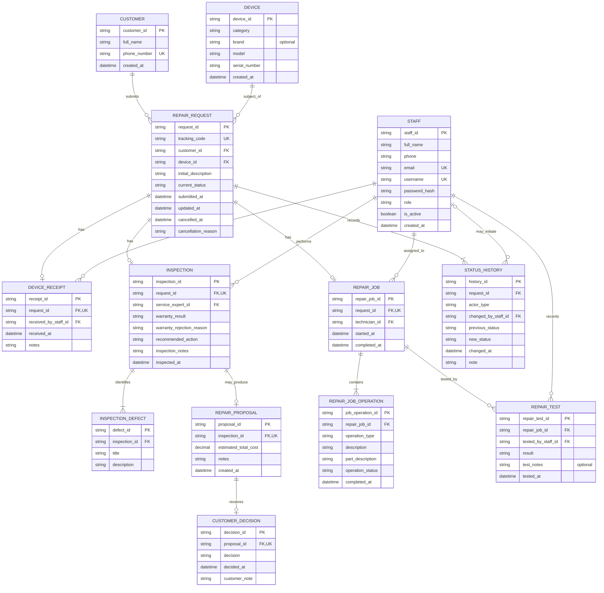

# نمودار موجودیت‌ـ‌رابطه (ERD) — GaranTech

**مبنای نمودار:** `docs/design/data-model.md`  
**تعداد موجودیت‌ها:** 13  
**نوع نمودار:** Logical ERD

این نمودار روابط، کلیدهای اصلی، کلیدهای خارجی و کاردینالیتی‌های مدل منطقی GaranTech را نمایش می‌دهد. نام موجودیت‌ها و ویژگی‌ها انگلیسی نگه داشته شده‌اند تا با نام‌گذاری فنی و پیاده‌سازی آینده سازگار باشند.

## 1. نمودار کامل

## 2. توضیحات اختیاری بودن ویژگی‌ها

در موجودیت DEVICE، ویژگی `brand` اختیاری است؛ ویژگی‌های `category` و `model` الزامی‌اند و `serial_number` نیز در صورت نبود شماره سریال می‌تواند خالی باشد. در REPAIR_TEST، ویژگی `test_notes` اختیاری است؛ توضیح برای نتیجه FAILED در لایه برنامه الزامی و برای PASSED اختیاری است.

## 3. راهنمای کاردینالیتی

| نماد Mermaid | معنا |
|---|---|
| `||` | دقیقاً یک |
| `o|` | صفر یا یک |
| `o{` | صفر یا چند |
| `|{` | یک یا چند |

برای نمونه، رابطه Customer و RepairRequest نشان می‌دهد هر درخواست دقیقاً متعلق به یک مشتری است، اما یک مشتری می‌تواند هیچ درخواست یا چند درخواست داشته باشد.

## 3. نکات مهم در خواندن نمودار

1. **Inspection و InspectionDefect:** ایرادهای تشخیص‌داده‌شده به کارشناسی متصل‌اند، نه مستقیماً به درخواست؛ شرح اولیه مشتری در RepairRequest باقی می‌ماند.
2. **Inspection و RepairProposal:** پیشنهاد هزینه اختیاری است؛ فقط برای درخواست خارج از گارانتی ایجاد می‌شود. درخواست تحت گارانتی مستقیماً آماده تعمیر می‌شود.
3. **RepairProposal و CustomerDecision:** تصمیم مشتری فقط برای پیشنهاد هزینه خارج از گارانتی ثبت می‌شود.
4. **RepairJob و RepairJobOperation:** عملیات واقعی مستقل از پیشنهاد هزینه است؛ بنابراین تعمیر تحت گارانتی نیز بدون ProposalItem قابل ثبت است.
5. **RepairJob و RepairTest:** هر فرایند تعمیر می‌تواند چند نتیجه آزمایش داشته باشد. آزمایش ناموفق درخواست را در IN_REPAIR نگه می‌دارد.
6. **StatusHistory:** هر درخواست یک رکورد اولیه وضعیت دارد. changed_by_staff_id برای رویدادهای با actor_type برابر STAFF مقدار دارد و برای CUSTOMER یا SYSTEM خالی است.

## 4. وضعیت‌های درخواست

مقادیر فنی مورد استفاده در RepairRequest.current_status و StatusHistory:

| مقدار | عنوان فارسی |
|---|---|
| REGISTERED | ثبت‌شده |
| RECEIVED | دریافت‌شده |
| INSPECTED | بررسی‌شده |
| AWAITING_CUSTOMER_DECISION | در انتظار تصمیم مشتری |
| READY_FOR_REPAIR | آماده تعمیر |
| IN_REPAIR | در حال تعمیر |
| COMPLETED | تکمیل‌شده |
| CANCELLED | لغوشده |

مقدار APPROVED در نسخه اولیه نمودار استفاده نمی‌شود؛ وضعیت درست طبق SRS و UC-12 برابر READY_FOR_REPAIR است.

## 5. قواعدی که با خط رابطه به‌تنهایی نمایش داده نمی‌شوند

ERD ساختار و کاردینالیتی را نمایش می‌دهد؛ اما برخی قواعد کسب‌وکار باید در مدل داده و منطق برنامه نیز enforce شوند:

- RepairProposal فقط وقتی مجاز است که Inspection.warranty_result برابر NOT_ELIGIBLE باشد.
- برای ELIGIBLE، RepairProposal و CustomerDecision نباید ایجاد شوند.
- برای NOT_ELIGIBLE، پیش از شروع RepairJob باید پیشنهاد هزینه و تصمیم ACCEPTED وجود داشته باشد.
- فقط کارشناس خدمات می‌تواند DeviceReceipt و Inspection را ثبت کند.
- فقط تعمیرکار می‌تواند RepairJob را اجرا و RepairTest را ثبت کند.
- RepairJob فقط پس از READY_FOR_REPAIR آغاز می‌شود.
- FAILED وضعیت را تغییر نمی‌دهد؛ PASSED باعث COMPLETED شدن درخواست توسط سامانه می‌شود.
- CANCELLED و COMPLETED وضعیت‌های نهایی‌اند.
- current_status باید با آخرین رکورد StatusHistory سازگار باشد.

